<div align="center">

# 🌳 Impact Forest

### Every good deed grows your forest.

**🏆 Winner of the Virgin case at [START Hack 2025](https://www.startglobal.org/start-hack)** · Finalist pitch on the START Summit main stage · St. Gallen, Switzerland

[**🌐 Project page**](https://alextheprophecy.github.io/starthack2025/) · [Features](#features) · [Run it locally](#run-it-locally) · [Tech stack](#tech-stack)

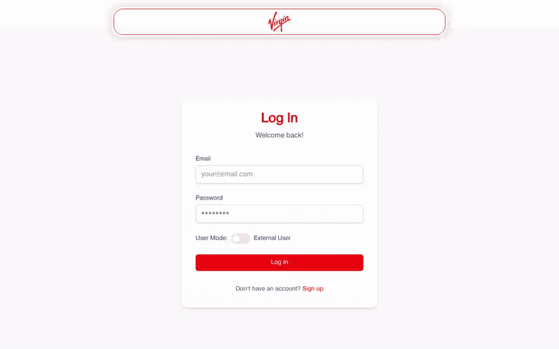

</div>

---

## The story

At **START Hack 2025** (19–21 March 2025, St. Gallen), Virgin asked teams to help it get more people involved in the causes run across the Virgin group, from Virgin Unite and Virgin Atlantic to Virgin Voyages and Virgin Media O2.

Our answer was **Impact Forest**, a gamified impact platform. You discover Virgin initiatives picked for you, join them by volunteering, donating or taking part, and earn Virgin Points. Every contribution plants something in your own **3D Impact Forest**, which grows with you and which your friends can see.

We **won the Virgin case**, which also won us a **Meta Quest 3**, and pitched in the **finals on the START Summit main stage** to the audience and a panel of investors.

<table>
  <tr>
    <td width="50%">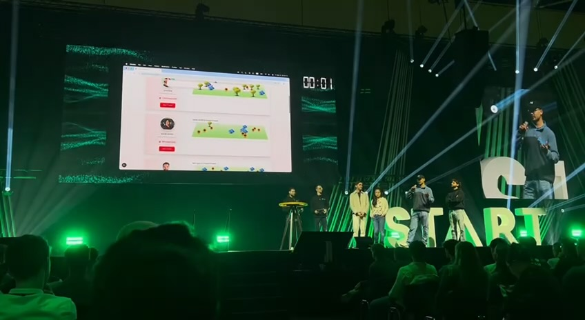</td>
    <td width="50%"></td>
  </tr>
  <tr>
    <td align="center"><sub>Live demo on the finals stage: our friends' forests on the big screen</sub></td>
    <td align="center"><sub>Winning the Virgin case in front of the investor panel</sub></td>
  </tr>
</table>

---

## Features

### 🌱 Your Impact Forest
Each initiative you join grows a new element in a perspective-rendered meadow:

| | Category | Grows a… |
|---|---|---|
| 🌳 | **Environmental** | low-poly tree |
| 🌻 | **Social impact** | sunflower |
| 🔆 | **Innovation** | solar panel |
| ⭐ | **Special rewards** | e.g. a starfish for supporting *Saving the Turtles* |

Placement is **procedural but seeded**: items are scattered over a trapezoid grid with depth-based scaling, so each user gets a unique forest that looks the same on every visit. Each item springs into place one after another.

<p align="center">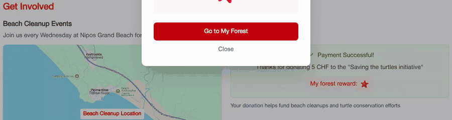</p>

### ✨ Virgin Points dashboard
Your points count up live and split into Environmental, Social and Innovation. From there you can redeem them through **Virgin Red** or at **Virgin Hotels**.

<p align="center">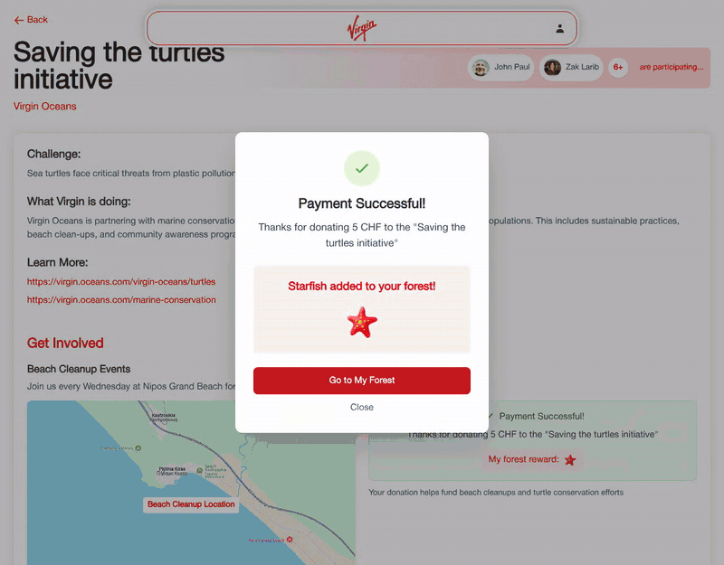</p>

### 👫 Friends & their forests
Browse your connections as cards, then switch to **Forest View** to compare everyone's impact. Each friend's forest is generated from their own seed and contributions.

<p align="center">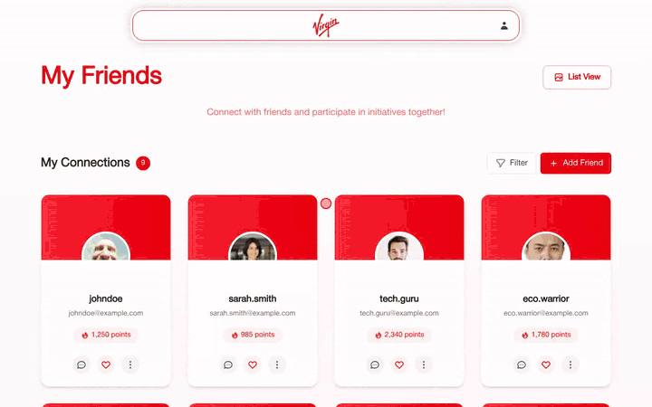</p>

### 🎯 Personalised discovery
After a short "calculating your preferences" step, you see recommended initiatives first, then every initiative grouped by Virgin company. The data comes from Virgin's own initiative dataset.

<table>
  <tr>
    <td width="50%">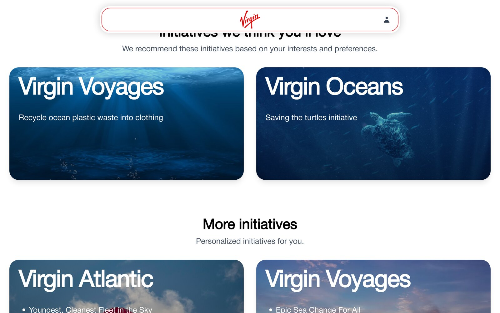</td>
    <td width="50%">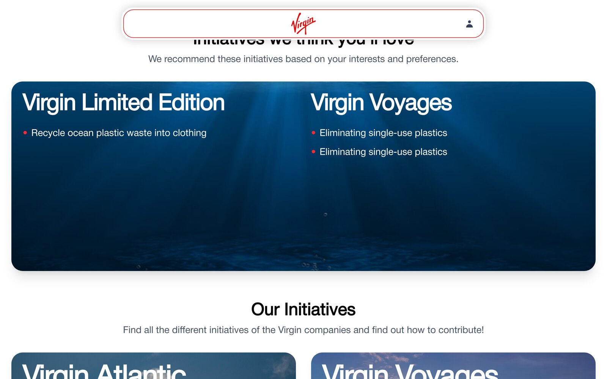</td>
  </tr>
</table>

### 🐢 Initiative pages that drive action
Each initiative page covers the challenge, what Virgin is doing, and which friends are already taking part. For *Saving the Turtles* you can also find the local beach clean-up on a map, contact the organiser, or donate in one tap. A donation unlocks a special reward for your forest.

<table>
  <tr>
    <td width="50%">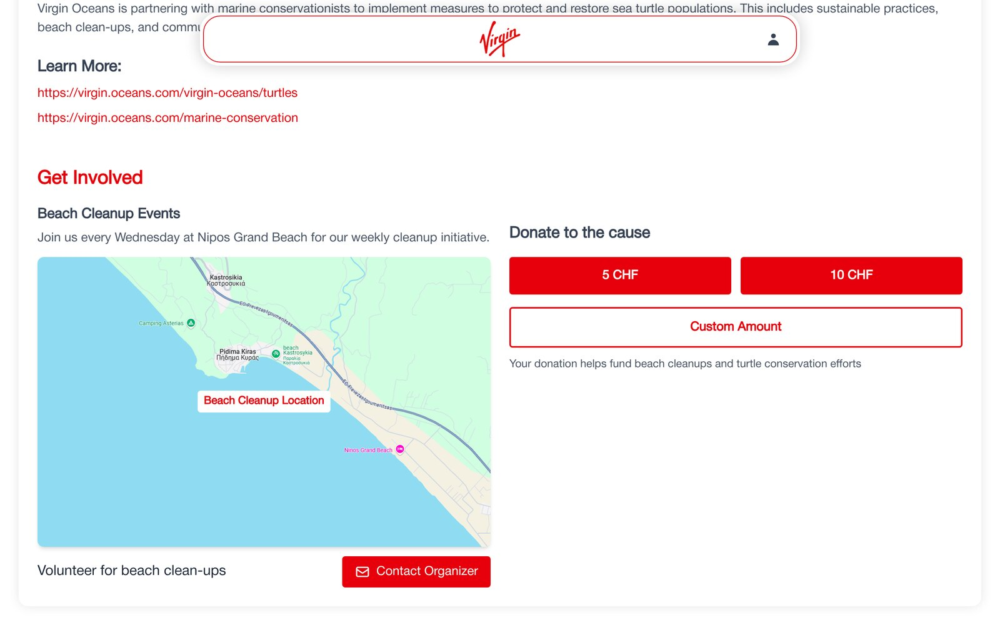</td>
    <td width="50%">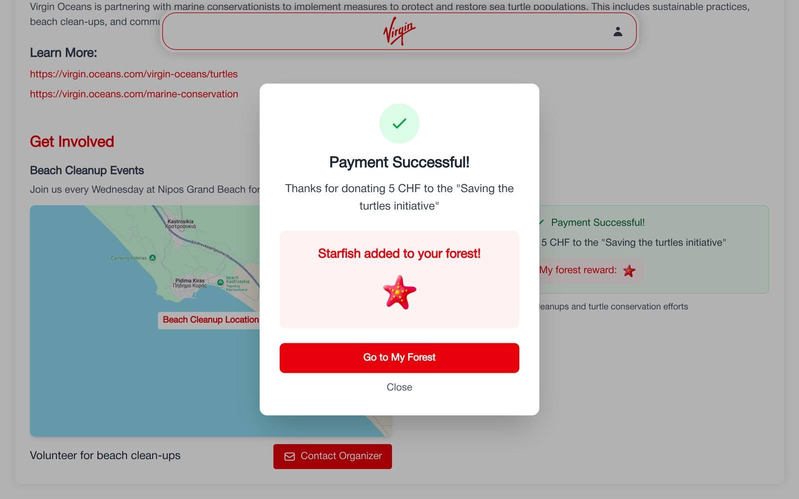</td>
  </tr>
</table>

### 🏢 Internal mode for Virgin employees
Toggle **Internal Employee** at login to open a form for publishing new challenges (company, initiative, challenge, call to action, links, reward category). They are saved through a Next.js API route.

<details>
<summary><b>More screenshots</b></summary>
<br>

| Login | Friends (card view) |
|---|---|
| 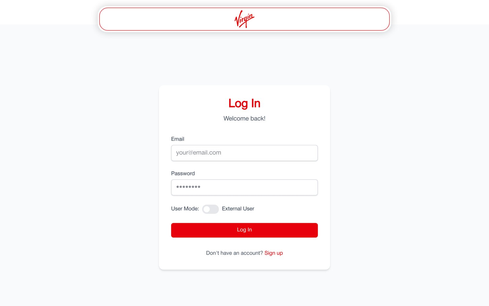 | 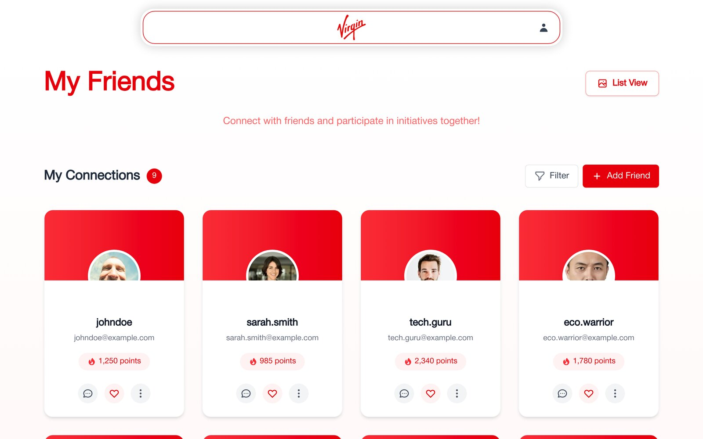 |

| My Initiatives | Friends (forest view) |
|---|---|
| 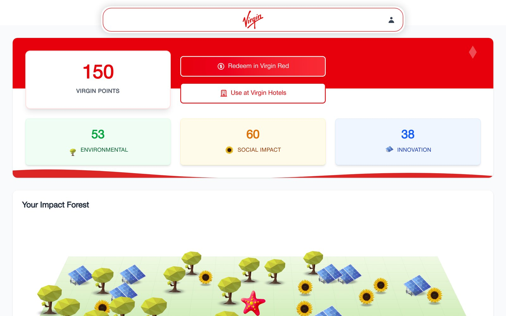 | 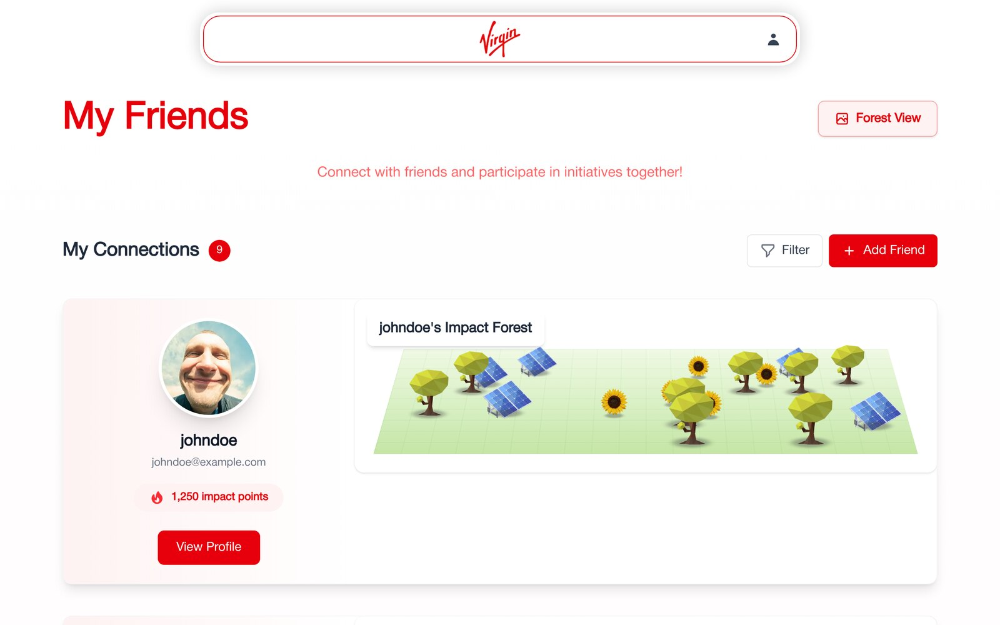 |

</details>

---

## Tech stack

- **[Next.js 15](https://nextjs.org/)** (App Router) + **React 19** + **TypeScript**
- **Tailwind CSS 4** for styling, in Virgin red
- **Framer Motion** for page and card animations, plus **react-countup** for the points counter
- **Next.js API routes** backed by JSON files for users, friends and challenges (enough for a hackathon)
- The Impact Forest is plain React + CSS 3D transforms (`perspective` + `rotateX`) with a seeded PRNG and staggered spring transitions. No canvas or WebGL.

```
src/app
├── page.tsx                      # Recommended initiatives (home)
├── initiatives/                  # All initiatives by Virgin company
├── initiative/[company]/[name]/  # Initiative detail, donation flow
├── my-initiatives/               # Points dashboard + Impact Forest
├── socials/                      # Friends: card view / forest view
├── internal/                     # Employee tool to publish challenges
├── components/ImpactForest.tsx   # The forest renderer
└── api/                          # users, friends, challenges
```

## Run it locally

```bash
npm install
npm run dev
```

Open <http://localhost:3000> and log in with the demo account **`user@gmail.com` / `testing`** (more accounts are listed in `public/users.json`). On the "Calculating your preferences…" screen, click anywhere to continue.

> **Note:** this is hackathon code. Auth is a client-side demo on top of `sessionStorage`, data lives in JSON files, and some friend and initiative data is mocked for the live pitch. Navigate through the UI rather than typing URLs directly.

## Team

Built at START Hack 2025 by:

- [@alextheprophecy](https://github.com/alextheprophecy)
<!-- Add teammates here: - [Name](https://github.com/handle) -->

---

<div align="center"><sub>Built for the Virgin case at START Hack 2025. Virgin and the Virgin logo are trademarks of Virgin Enterprises Ltd; this is an independent hackathon project.</sub></div>
